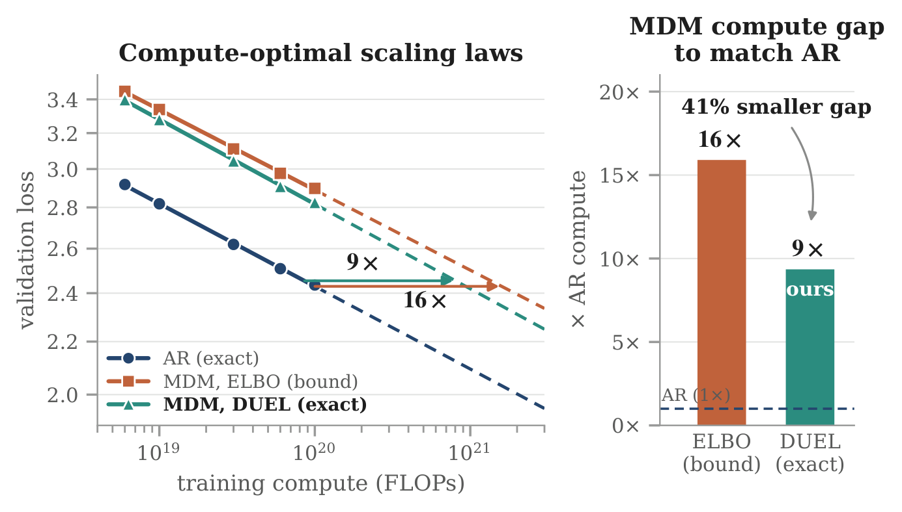

<div align="center">

# DUEL: Exact Likelihood Reshapes Masked Diffusion Scaling Laws and Beyond

[Gilad Turok](https://giladturok.github.io) &nbsp;·&nbsp; [Yair Schiff](https://yair-schiff.github.io) &nbsp;·&nbsp; [Chris De Sa](https://www.cs.cornell.edu/~cdesa/)\* &nbsp;·&nbsp; [Volodymyr Kuleshov](https://www.cs.cornell.edu/~kuleshov/)\*

Cornell University &nbsp;·&nbsp; \*Joint senior authorship

[](https://arxiv.org/abs/2603.01367)
[](https://giladturok.github.io/duel/)
[](LICENSE)



</div>

**TL;DR.** Masked diffusion models generate with deterministic unmasking rules, so their likelihood under the
sampler actually used is computable *exactly*: replay generation, reveal the true tokens instead of sampled ones,
and sum their log-probabilities. Measured this way, the MDM–AR scaling gap shrinks from 16× to 9× compute.

**Highlights**
- **Perplexity:** the MDM–AR gap shrinks by up to 32% in-domain and 82% zero-shot.
- **Scaling laws:** the MDM–AR compute gap falls from 16× to 9×.
- **Multiple choice:** DUEL improves LLaDA-8B accuracy on all six tasks, by up to 9.7 points.
- **Sampler selection:** DUEL agrees with a gold-standard LLM judge on every decided comparison; generative
  perplexity and MAUVE do not.

> [!NOTE]
> **Full code coming soon.** This repository is a minimal reference implementation of DUEL to get started
> (`src/duel.py`, `src/rules.py`, and a LLaDA example).

<details>
<summary><b>Abstract</b></summary>
<br>

Masked diffusion models (MDMs) are trained to predict tokens in every order but generate in one. As such, MDM
likelihood is an intractable sum over all orders. The evidence lower bound (ELBO) is used as a proxy for
likelihood, but it is a loose bound and assumes positions are unmasked uniformly at random. Frontier MDMs,
however, select positions with deterministic rules such as confidence. To resolve this mismatch we introduce
DUEL, a framework that unifies common deterministic MDM samplers. DUEL allows for likelihood computation that is
both exact and under the sampler that is actually used during generation. DUEL is a simple plug-and-play
algorithm applicable to any pretrained MDM with no retraining. To compute the likelihood of a text sequence,
simply replay generation, reveal the true tokens instead of sampled ones, and sum their log-probabilities.
Evaluating with DUEL instead of the ELBO changes what we conclude about MDMs. The perplexity gap between MDMs and
autoregressive (AR) models shrinks by up to 32% in-domain and 82% zero-shot. In scaling laws, the reported 16×
MDM–AR compute gap falls to 9× under DUEL, revealing more than ⅓ is an evaluation artifact. Scoring
multiple-choice answers with likelihood via DUEL instead of the ELBO improves LLaDA-8B accuracy on all six tasks,
by up to 9.7 points. DUEL also selects samplers correctly: it matches a gold-standard LLM judge on every decided
comparison, which generative perplexity and MAUVE fail to do. DUEL reveals that MDMs are ultimately more
competitive with AR models than the ELBO initially suggests.

</details>

## How DUEL works

Sampling and scoring are the same loop: same rule, same revealed sets, same forward passes. Only one line differs.

```
sample(denoiser, rule)                     log_likelihood(x, denoiser, rule)
  while masked tokens remain:                while masked tokens remain:
    P = denoiser(x)                            P = denoiser(x)
    I = rule(P, masked)                        I = rule(P, masked)
    for l in I:                                for l in I:
      x[l] ~ Cat(P[l])                           ll += log P[l][x[l]]
    unmask I                                   unmask I
  return x                                   return ll        # exact
```

| File | Contents |
|---|---|
| [`src/duel.py`](src/duel.py) | `sample` (Algorithm 1), `log_likelihood` (Algorithm 2), batching helpers |
| [`src/rules.py`](src/rules.py) | Unmasking rules and `Block` for block decoding |
| [`src/example.py`](src/example.py) | End-to-end demo with LLaDA-8B-Instruct |

## Installation

```bash
git clone https://github.com/kuleshov-group/duel.git && cd duel
uv sync                                   # creates .venv from uv.lock
```

Without uv: `pip install torch transformers==4.49.0`. The lock file pins PyTorch to the CUDA 12.8 wheels.

## Quickstart

### Command line

```bash
uv run src/example.py --rule threshold --mu 0.9 --block_size 32 --gen_len 128 --temperature 0.5
```

This samples from LLaDA-8B-Instruct for a batch of prompts, then computes the exact log-likelihood of the
samples under the same sampler. Other flags: `--rule {l2r,confidence,margin,threshold,klass}`, `--k`, `--nu`,
`--block_size 0` (no blocks).

### Python API

Run from `src/`, or put it on the path with `PYTHONPATH=src`:

```python
import torch
from transformers import AutoModel, AutoTokenizer
from duel import make_canvas, sample, log_likelihood
from rules import Block, ConfidenceThreshold

name = "GSAI-ML/LLaDA-8B-Instruct"
tok = AutoTokenizer.from_pretrained(name, trust_remote_code=True)
model = AutoModel.from_pretrained(name, trust_remote_code=True, torch_dtype=torch.bfloat16).cuda().eval()
MASK = 126336

chats = [[{"role": "user", "content": q}] for q in ["What is 2 + 2?", "Name three primes."]]
prompts = [tok.apply_chat_template(c, add_generation_prompt=True) for c in chats]
x, attn = (t.cuda() for t in make_canvas(prompts, gen_len=64, mask_id=MASK, pad_id=tok.pad_token_id))

denoiser = lambda z: model(z, attention_mask=attn).logits   # tokens -> logits [B, L, V]
rule = Block(ConfidenceThreshold(mu=0.9), block_size=32)

out, nfe = sample(denoiser, rule, x, MASK, temperature=0.5)
ll, _ = log_likelihood(denoiser, rule, out, x == MASK, MASK, temperature=0.5)  # exact log p(out)
```

To score existing text (e.g. multiple-choice answers), build the batch with `make_scoring_batch(prompts,
continuations, pad_id)`, which returns `x, attention_mask, gen_mask`.

Notes:
- Rules see the untempered `softmax(logits)`, so `mu=0.9` means the same at every temperature. `temperature`
  only sets the distribution tokens are drawn from and scored under. `log_likelihood` needs `temperature > 0`.
- At `temperature=0`, `Block(Confidence(1), 32)` matches LLaDA's own `generate` (low-confidence remasking,
  one token per step) token for token on the prompts we checked.

## Unmasking rules

$p^{(1)}, p^{(2)}$ are the largest and second-largest predicted probabilities at a position.

| Rule | Hyperparameters | Reveals per step | Reference |
|---|---|---|---|
| `LeftToRight` | `k` | `k` leftmost masked positions (`k=1` is autoregressive) | |
| `Confidence` | `k` | top-`k` by $p^{(1)}$ | Nie et al., 2025 |
| `Margin` | `k` | top-`k` by $p^{(1)} - p^{(2)}$ | Kim et al., 2025 |
| `ConfidenceThreshold` | `mu` | all with $p^{(1)} \ge \mu$ (adaptive) | Wu et al., 2025 (Fast-dLLM) |
| `KLASS` | `mu`, `nu` | $p^{(1)} \ge \mu$ and KL(previous ‖ current) $\le \nu$ (adaptive) | Kim et al., 2025 |
| `Block(rule, block_size)` | `block_size` | the inner rule, within the leftmost unfinished block | Arriola et al., 2025 |

Adaptive rules fall back to the most confident position when nothing passes, so every step makes progress
and the loop simply runs until nothing is masked.

### Writing your own rule

A rule is called as `reveal = rule(probs, masked)` with `probs: [B, L, V]` and
`masked, reveal: Bool[B, L]`. Subclass `rules.Rule` and make sure that

- `reveal` is a subset of `masked`, with at least one position for every row that still has masks;
- `reveal` is a deterministic function of `probs` and `masked` (stateful rules may also use earlier steps;
  clear that state in `reset()`). In particular, it must not depend on the sampled tokens.

## Batching and padding

A batch is two left-padded tensors: `x: Long[B, L]`, where `mask_id` marks the positions to generate or score,
and a boolean `attention_mask` that is `False` on padding. Prompts and padding are never masked, so rules
never see them. Rows may finish at different steps, and `Block` tracks each row's own starting column.
The attention mask is passed explicitly because LLaDA's pad token is also its end-of-text token.

### Other models

`duel.py` only needs a function from tokens to logits where position `l` predicts token `l`.
For a model other than LLaDA, write that wrapper (e.g. undo a one-position logit shift).

## Citation

```bibtex
@article{turok2026duel,
  title   = {{DUEL}: Exact Likelihood Reshapes Masked Diffusion Scaling Laws and Beyond},
  author  = {Turok, Gilad and Schiff, Yair and De Sa, Chris and Kuleshov, Volodymyr},
  journal = {arXiv preprint arXiv:2603.01367},
  year    = {2026}
}
```

## License

[Apache 2.0](LICENSE)
